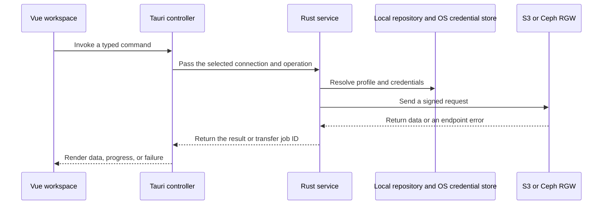

# StoreForge

A standalone Rust and Vue desktop client for Amazon S3, Ceph RGW, and S3-compatible endpoints. Use **Explore the demo** to inspect the object workspace with sample data.

## Decisions

- Vue features own their models, views, stores, and Tauri API calls. Rust feature modules separate controller, service, repository, and model code. Tauri wires the modules into one process.
- A connection records endpoint, region, addressing style, and optional known buckets. Access keys and session tokens are stored in macOS Keychain, Windows Credential Manager, or Linux Secret Service.
- Standard object operations use the AWS SDK. Bucket configuration and administrative requests use SigV4 against the selected provider. Ceph RGW Admin Ops requires a Ceph connection with the corresponding capabilities.
- Transfers run in the desktop process. Activity records progress, individual failures, interrupted jobs, and endpoint actions locally. Uploads and transfers check for existing destination keys before writing and request conditional writes.

## Limits

- BucketReef's hosted administration covers shared UI identities, SSO, delegated portal access, help requests, and an always-running scheduler. StoreForge covers direct endpoint access under the selected connection's permissions. Those shared services are outside this implementation.
- Endpoint support varies by provider and version. IAM, SNS, Object Lock, and Ceph Admin Ops require compatible APIs and permissions. When a provider ignores conditional writes, destination checks cannot lock out concurrent writers. Cross-endpoint transfers use temporary disk space, and migration copies current objects.
- SSE-C object encryption, OpenStack Swift sessions, and coordinated Ceph maintenance campaigns remain outside the desktop feature set.
- Integrity checks compare the listing with object metadata. Comparison reports ETag differences separately because ETags can depend on encryption and multipart layout.
- Downloaded macOS releases require Developer ID signing and notarization for normal Gatekeeper approval. Local builds installed with `make install` use ad hoc signing when needed.

## Commands

```sh
make dev
make test
make check
make build
make install
```

`make install` builds and replaces `/Applications/StoreForge.app` on macOS. The release pipeline builds Apple Silicon and Intel DMGs, a Windows x64 NSIS installer, and Linux x64 AppImage and Debian packages. A draft becomes public after the full matrix succeeds.

Run the endpoint integration test against a disposable S3-compatible endpoint. It creates and removes its own versioned bucket.

```sh
STOREFORGE_TEST_S3_ENDPOINT=http://127.0.0.1:5178 \
  cargo test --locked --manifest-path src-tauri/Cargo.toml endpoint_object_lifecycle -- --ignored
```

Set `STOREFORGE_TEST_S3_ACCESS_KEY`, `STOREFORGE_TEST_S3_SECRET_KEY`, and `STOREFORGE_TEST_S3_REGION` for the test service. Set `STOREFORGE_TEST_CEPH=1` when testing Ceph RGW.
